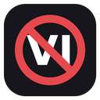
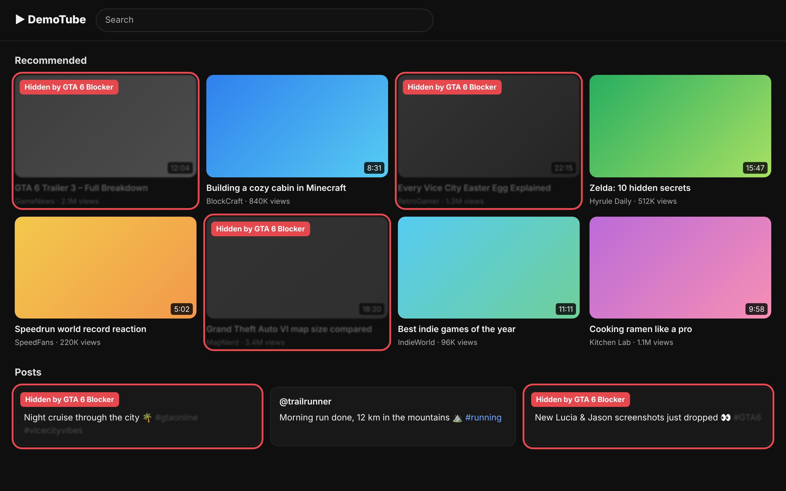
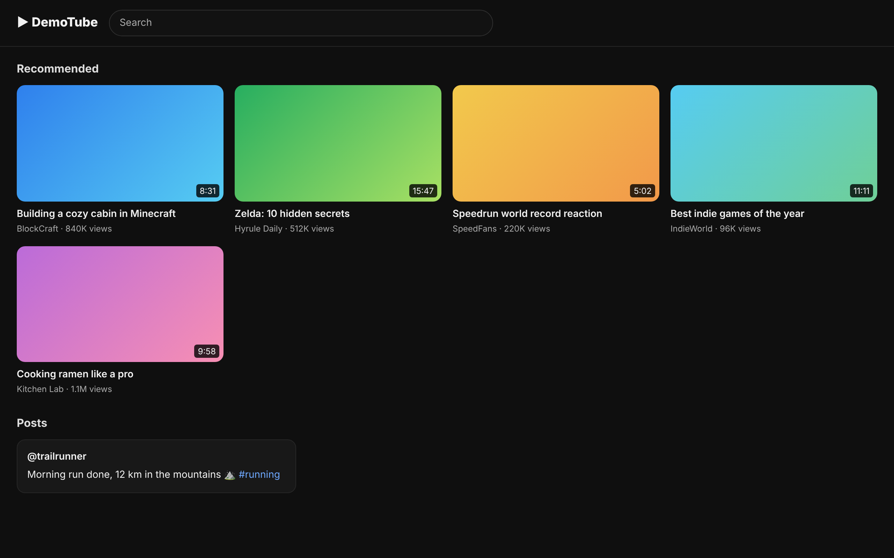
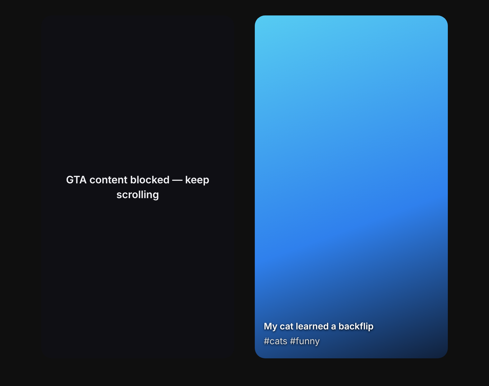
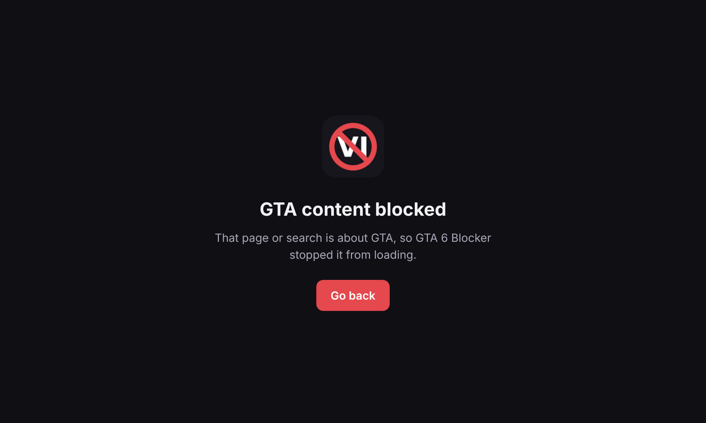
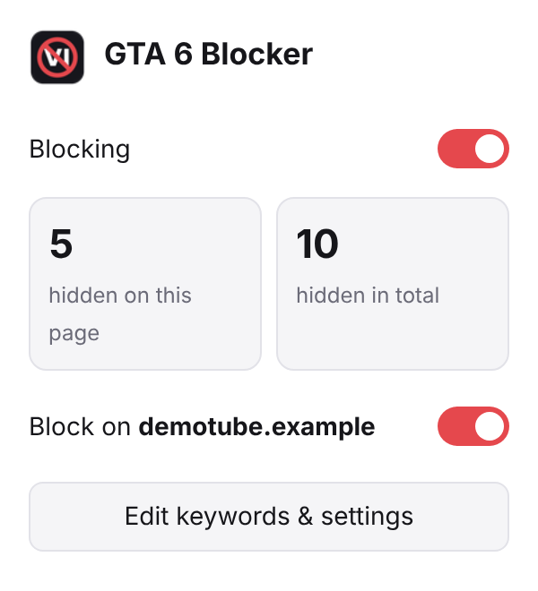
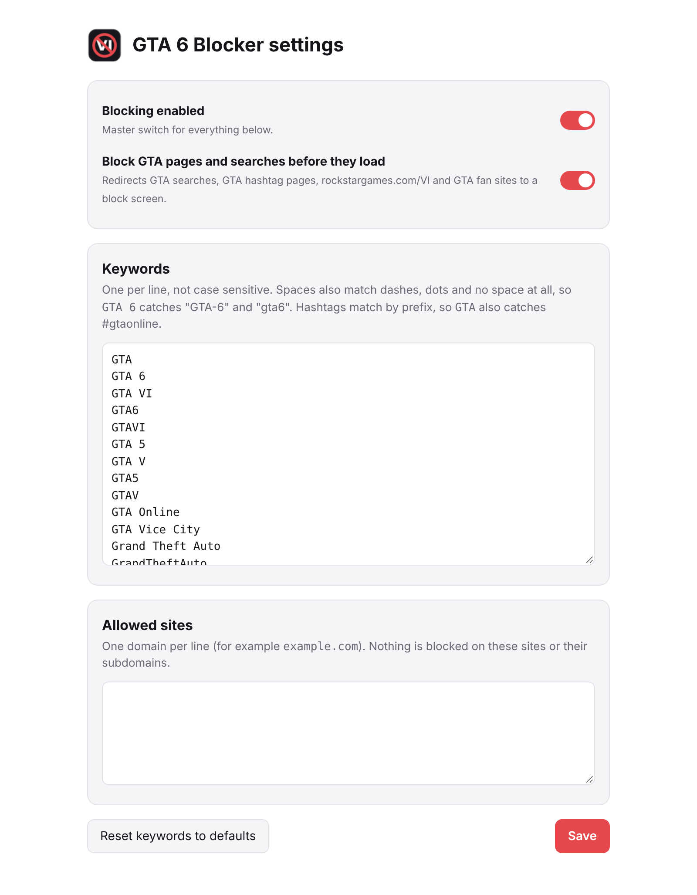

<p align="center">
  
</p>

<h1 align="center">GTA 6 Blocker</h1>

<p align="center">
  <b>Stay spoiler-free until release day.</b><br>
  A free, open-source browser extension that hides everything about <b>GTA 6 / Grand Theft Auto VI</b>, and Grand Theft Auto in general: trailers, leaks, search results, YouTube videos and Shorts, Reels, posts and hashtags.
</p>

<p align="center">
  
  
  
  
  
  <a href="https://backware.cc"></a>
</p>

> [!NOTE]
> **This project was generated with AI.** The code, tests, icons and docs were written by [Claude](https://claude.ai) (Anthropic's AI assistant) on request, then tested and reviewed by a human. Expect the odd rough edge. Issues and pull requests are very welcome.

## Screenshots

**What gets blocked:** the same feed with the extension on. Everything marked in red is GTA related and gets removed. Minecraft, Zelda and the running post stay.



| Without the extension | With GTA 6 Blocker (what you actually see) |
| --- | --- |
|  |  |

| Shorts / Reels / TikTok | GTA searches and pages | Popup |
| --- | --- | --- |
|  |  |  |

<details>
<summary>Settings page</summary>



</details>

<sub>Screenshots use a mock demo page (`docs/demo/`), regenerated with `node docs/demo/take-screenshots.js`.</sub>

## How it works

1. **Network rules** stop GTA searches, hashtag pages, GTA pages on rockstargames.com and GTA fan sites before they even load, and show a block screen instead.
2. A **content script** reads every page you visit (text, links, image alt text, titles, hashtags) and hides the whole "card" around anything GTA related: a search result, a video tile, a post or a comment.
3. A **MutationObserver** keeps watching, so content that appears later through infinite scroll or single-page navigation gets hidden too.
4. In **swipe feeds** (Shorts, Reels, TikTok) a GTA video is covered and muted instead of removed, so you can keep scrolling.

Everything runs locally in your browser. No tracking, no analytics, no remote code, no data leaves your machine.

## What it blocks

| Where | How |
| --- | --- |
| **Whole pages** | Pages whose URL, title or `og:title` mention GTA 6 are covered by a block screen and their videos are paused. |
| **Before they load** | Any GTA search (`gta 6`, `grand theft auto v`, `vice city`, `#gtaonline`...) on Google, Bing, DuckDuckGo, YouTube, Instagram, X etc., GTA hashtag pages, `rockstargames.com/VI` and other GTA pages on Rockstar's site, GTA fan sites (GTAForums, GTABase, the GTA wiki...) and embedded GTA iframes are stopped at the network level. |
| **Search results** | Google, Bing, DuckDuckGo, Brave, Ecosia, Yahoo result cards. |
| **Videos** | YouTube home, search, sidebar, Shorts shelves, comments and community posts; Twitch and TikTok cards. |
| **Swipe feeds** | In the YouTube Shorts player, Instagram Reels, TikTok and Facebook Reels, a GTA video is covered with a block screen and muted, and you can keep scrolling to the next one. |
| **Social posts** | Reddit, X/Twitter, Bluesky, Mastodon, Facebook and Instagram posts, captions, hashtags, grid tiles and comments. |
| **Everything else** | Any element on any site whose text, link, image `alt`, `title` or `aria-label` matches a keyword, including content loaded later by infinite scroll. |

Matching is smart about spelling:

- `GTA 6` also catches `GTA-6`, `gta6`, `GTA_6` and `GTA:6`.
- Hashtags match by prefix, so `GTA` catches `#gta6`, `#gtaonline`, `#gtarp`, `#GTAV`, and `Vice City` catches `#vicecityvibes`.
- Whole words only: `GTA` won't hide "agtamon", `Vice City` won't hide "vice president", and `Jason Duval` won't hide "Jason Momoa".

Default keywords: `GTA`, `GTA 6`, `GTA VI`, `GTA 5`, `GTA V`, `GTA Online`, `Grand Theft Auto`, `Vice City`, `Leonida`, `Port Gellhorn`, `Ambrosia County`, `Jason and Lucia`, `Jason Duval`, `Lucia Caminos` and spelling variants. You can edit them in the settings.

## Features

- One-click on/off switch in the toolbar popup
- "Block on this site" switch to allow a site
- Badge counter showing how many items were hidden on the current tab
- Editable keyword list and allowlist in the settings page
- No tracking, no network calls, no remote code. Settings stay in your browser.

## Install

### Chrome on Windows (also Edge, Brave, Opera)

1. Download the latest `gta6-blocker-chrome-*.zip` from [Releases](../../releases) and unzip it, or download this repository (green **Code** button → **Download ZIP**), or `git clone` it.
2. Open `chrome://extensions` (Edge: `edge://extensions`).
3. Turn on **Developer mode** (top right).
4. Click **Load unpacked** and pick the unzipped folder (or the **`src`** folder of the repository).
5. Pin the extension with the puzzle-piece icon so you can see the counter.

To update later, replace the files and click the reload arrow on the extension card.

### Safari (macOS)

You need **Xcode** from the Mac App Store (open it once after installing). No Apple developer account is needed for a local build.

**One click:** double-click **`Build Safari Extension.command`** in Finder. The first time, right-click it and choose **Open**, because macOS asks before running downloaded scripts.

Or from Terminal:

```sh
bash scripts/build-safari.sh
```

The script generates the Xcode project, sets the version, the deployment target (macOS 12+) and local signing, builds it, installs **GTA 6 Blocker.app** into `~/Applications` and launches it once so Safari sees the extension.

Then turn it on in Safari:

1. **Safari → Settings → Advanced →** tick **Show features for web developers**.
2. **Safari → Settings → Developer →** tick **Allow unsigned extensions**.
3. **Safari → Settings → Extensions →** enable **GTA 6 Blocker**, then **Edit Websites… → Other Websites → Allow**.

> [!IMPORTANT]
> A locally signed build is switched off by Safari **every time Safari quits**, and you have to tick *Allow unsigned extensions* again. To keep it on permanently, sign it with an Apple ID. See [Signing for Safari](#signing-for-safari) below.

Other options:

- `bash scripts/build-safari.sh --open` only creates the Xcode project and opens it.
- `bash scripts/build-safari.sh --ios` also creates iPhone/iPad targets.

If the build fails, the errors are printed and the full log is in `build/xcodebuild.log`.

## Signing for Safari

Safari only keeps an extension enabled across restarts when its app is signed with an Apple certificate. Pick the option that fits:

| Option | Cost | Stays on after restart | Can share with others |
| --- | --- | --- | --- |
| **A. Local signing** (default script) | Free | No | No |
| **B. Personal Team** (free Apple ID) | Free | Yes, on your Mac | No |
| **C. Developer ID + notarization** | Apple Developer Program, $99/year | Yes | Yes, as a download |
| **D. Mac App Store** | Apple Developer Program, $99/year | Yes | Yes, via the App Store |

### B. Sign with a free Apple ID (recommended for personal use)

1. In **Xcode → Settings → Accounts**, click **+** and sign in with your Apple ID. Xcode creates a free *Personal Team*.
2. Create the project without building it:
   ```sh
   bash scripts/build-safari.sh --open
   ```
3. In Xcode, select the blue project icon at the top of the sidebar. For **both** targets (**GTA 6 Blocker** and **GTA 6 Blocker Extension**), open **Signing & Capabilities** and:
   - tick **Automatically manage signing**
   - set **Team** to *Your Name (Personal Team)*
4. Pick the **GTA 6 Blocker** scheme and **My Mac** at the top, then press **⌘R**.
5. In **Safari → Settings → Extensions**, enable **GTA 6 Blocker**. You don't need *Allow unsigned extensions* any more.

Tip: if you know your team ID (shown in Xcode under Accounts or on developer.apple.com), `DEVELOPMENT_TEAM=ABCDE12345 bash scripts/build-safari.sh` does steps 2 to 4 in one go.

### C. Share it as a download (Developer ID)

1. Join the [Apple Developer Program](https://developer.apple.com/programs/).
2. Open the project with `bash scripts/build-safari.sh --open` and set your paid team on both targets as above.
3. Use a bundle ID you own: `BUNDLE_ID=com.yourname.gta6blocker bash scripts/build-safari.sh --open` (the extension automatically gets `com.yourname.gta6blocker.Extension`).
4. **Product → Archive**, then in the Organizer **Distribute App → Direct Distribution**. Xcode signs it with your *Developer ID* and sends it to Apple for notarization.
5. Export the notarized app, zip it and attach it to a GitHub release. Users drag it to Applications, open it once and enable the extension in Safari.

### D. Publish on the Mac App Store

Same as C, but choose **App Store Connect** in step 4, then fill in the listing in [App Store Connect](https://appstoreconnect.apple.com) and submit for review. This also works for the iOS/iPadOS version (`--ios`).

## Usage

- Click the toolbar icon to switch blocking on or off, see the counters, or allow the current site.
- **Edit keywords & settings** opens the settings page, where you can change keywords (one per line), add allowed sites and switch the "block before load" network rules on or off.

## Development

```
src/
  manifest.json        Manifest V3, shared by Chrome and Safari
  shared.js            Settings + keyword matcher (used everywhere)
  content.js / .css    Page scanner, MutationObserver, block overlay
  background.js        Network rules sync, badge counter
  rules/rules.json     declarativeNetRequest rules (URL / search blocking)
  popup/  options/  blocked/  icons/
scripts/
  build-safari.sh      Wrap src/ into a Safari Xcode project
  package-chrome.sh    Zip src/ for the Chrome Web Store (macOS/Linux)
  package-chrome.ps1   Same, for Windows PowerShell
test/
  run-test.js          Headless Chromium test (39 checks)
docs/
  demo/                Mock pages + script that make the README screenshots
  screenshots/
```

There's no build step: edit files in `src/` and reload the extension.

Run the automated test (needs Node 18+):

```sh
npm install
npx playwright install chromium
npm test
```

## Limitations

- Text inside images and video frames can't be read, so a thumbnail without a GTA 6 title or alt text won't be caught.
- Sites that render into a `<canvas>` or a closed shadow DOM can't be inspected.
- Very generic words can cause false positives. `GTA` is also short for "Greater Toronto Area", so posts about Toronto may be hidden too. Remove a keyword in the settings if it hides too much.

## Contributing

Pull requests are welcome, especially new site selectors and keywords. See [CONTRIBUTING.md](CONTRIBUTING.md).

## Credits

Generated with AI by [Claude](https://claude.ai) (Anthropic), directed, tested and maintained by **Backware**.

## Contact

Questions, ideas or business inquiries: **[backware.cc](https://backware.cc)**. For bugs and feature requests, please [open an issue](../../issues).

## License

[MIT](LICENSE). Not affiliated with Rockstar Games or Take-Two Interactive. "Grand Theft Auto" is a trademark of Take-Two Interactive Software, Inc.
